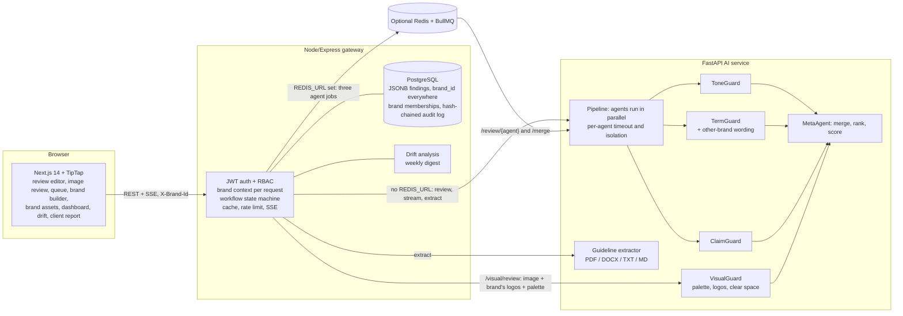

# Verity — Intelligent Brand Governance Platform
[](https://github.com/Swas00/verity/actions/workflows/ci.yml)
**Team Merge Conflicts** · Inkloom AI Hackathon, Brand Governance track · Round 2

> Every word. Every pixel. On brand.

AI agents check content against a brand's guidelines and explain every flag with the clause it breaks, a confidence score and a suggested fix.
People make the final call: a Creator → Manager → Approver workflow with a tamper-evident audit trail.
Nothing is published automatically.

**Try it:** open the live link and click **Start judge walkthrough**. No signup. A guided bar at the bottom walks through five steps.
Works on desktop and phone widths. **Live:** https://verity-two-delta.vercel.app  ·  API health: https://verity-api-f0xo.onrender.com/health/deep
(Free hosting: the first visit after a quiet period can take up to a minute to wake the API. The landing page says so while it waits and signs you in automatically once the server is ready.)

## What you can do
| Role | Flow |
|---|---|
| Manager (Rajan) | Upload a PDF/DOCX/TXT/MD guideline (or use the sample), review and edit what was extracted, publish it as a new versioned Brand Intelligence Graph |
| Creator (Maya) | Write or load sample content, run the review, watch agents report in as they finish, accept / edit / dispute each flag, re-run to see the score change and a text diff, submit |
| Manager | Queue with score, open flags, change since last revision and age; override flags (reason required), add a flag the AI missed, comment, approve / reject (reason) / escalate |
| Approver (Anita) | Final approve or send back escalations; approved content exports as text, Markdown or JSON; "Mark as published" is a human action |
| Managers and approvers | Dashboard (score trend, violations by agent / content type / creator, clauses reviewers keep overriding) and the audit trail (verify the hash chain, export CSV/JSON) |
| Anyone with several brands (Round 3) | Switch brand in the header: guidelines, reviews, audit trail, dashboard and notifications change with it, and so can the person's role (Maya is a creator at Lumina and a manager at Northwind). Wording from the *other* brand is flagged "other brand" |
| Creators and managers (Round 3) | **New image review**: upload a banner or graphic; VisualGuard marks problems with numbered boxes (colours outside the palette, a retired logo, a stretched, recoloured or crowded logo). Same decisions, approval and audit as text |
| Everyone | **Dark by default**, with a button in the header to switch to Light or to follow the computer's setting (System); the choice is remembered in the browser and applied before the page is drawn |
| Managers (Round 3) | **Brand assets** on the Brand page (logos, retired logos, palette); **Drift** page (which teams are slowly moving away from the guidelines, with a weekly digest and an alert); **client report** link from the dashboard (read-only, expiring, revocable) |

Seeded so nothing opens empty: two brands (Lumina Coffee Co. and Northwind Tea Co.) with their own guidelines, logos and palettes, about 140 historical reviews from four teams (ten weeks, with a planted drift in one), notifications, and a prompt-injection test sample.

## Architecture

More detail: [docs/ARCHITECTURE.md](docs/ARCHITECTURE.md) · API reference: [docs/openapi.yaml](docs/openapi.yaml) (checked against the code by a test and linted in CI) · Database diagram and measured indexes: [docs/DATABASE.md](docs/DATABASE.md).

## The agents
| Agent | Does | How |
|---|---|---|
| ToneGuard | Voice and tone against the brand's tone rules | LLM with schema-validated structured output and up to 3 repair retries. The live demo runs a deterministic **basic mode** (see below) |
| TermGuard | Banned and approved terminology, and (Round 3) wording that belongs to another brand the user also works on | Deterministic glossary match with variants and allowed contexts. The other-brand check compares the text with the user's other brands' names, approved terms, claims and tone examples and reports them as agent `brand` ("other brand") |
| ClaimGuard | Unsupported product claims | Finds claim-like sentences, then ranks them against the approved claims register (BM25, IDF-weighted coverage, typo-tolerant matching) and cites claim id, source document and page. A wrong number ("24 hours" vs the approved "48 hours") is flagged as a conflict even when the words match. "No supporting claim" is a distinct, explained outcome |
| VisualGuard (Round 3) | Images: colours outside the palette, a retired logo, a stretched, squashed, recoloured or crowded approved logo | Classical image processing, no model and no cost: k-means in Lab colour space against the brand's palette, and template matching on edge maps (coarse search over sizes and stretches, then a precise match) for the logos. Findings carry a rectangle of the image |
| MetaAgent | One clean result | Merges overlapping spans, ranks by severity and confidence, computes the 0–100 score, and tags low-confidence findings as suggestions |

Reliability built in: span verification (the server checks `text[start:end] == quoted_text`, re-locates or drops mismatches), one agent failing never blocks the others, a result cache keyed by content + guideline version, rate limiting, and a labelled precomputed result for the sample content if the AI service is unreachable. Other content is never faked.

**Learning loop.** Per rule, Verity tracks how often reviewers dispute or override its flags. Above 50% over at least 5 decisions the rule's confidence cutoff rises from 60% to 75%, so borderline findings become suggestions and stop lowering the score. The dashboard shows the cutoffs and flags the clause as possibly ambiguous.

**Security.** Roles are enforced server-side on every route (a creator token calling a manager endpoint gets 403, tested). Review content is passed to the model as delimited data, and a prompt-injection sample is included. Secrets live in environment variables only. The audit log is append-only: database triggers reject UPDATE, DELETE and TRUNCATE, and each entry hashes the previous one.

## Run locally
```bash
cp .env.example .env            # then export or copy the vars per service
cd ai  && python3 -m venv .venv && .venv/bin/pip install -r requirements.txt \
       && .venv/bin/uvicorn app.main:app --port 8000
cd api && npm install && PORT=4000 AI_SERVICE_URL=http://127.0.0.1:8000 npm start      # PGlite (in-process Postgres) if DATABASE_URL is unset
cd web && npm install && NEXT_PUBLIC_API_URL=http://127.0.0.1:4000 npm run dev
```
Open http://localhost:3000. No Docker is needed locally; set `DATABASE_URL` to use a real Postgres (see `docker-compose.yml`).

### Environment variables
| Variable | Service | Purpose |
|---|---|---|
| `JWT_SECRET` | api | Signs demo-login tokens |
| `WEB_ORIGIN` | api | Allowed browser origin (CORS) |
| `AI_SERVICE_URL`, `AI_SERVICE_TOKEN` | api, ai | Where the AI service is, and the shared secret between them |
| `DATABASE_URL` (`PGSSL=1` if needed) | api | PostgreSQL. Unset = in-memory PGlite (data lost on restart) |
| `SEED_HISTORY=off` | api | Skip the 40 demo reviews |
| `REDIS_URL`, `QUEUE_READY_TIMEOUT_MS` | api | Optional: run the review agents as BullMQ jobs. If Redis is unreachable the API falls back to the direct pipeline (waits at most `QUEUE_READY_TIMEOUT_MS`, default 3000) |
| `RUN_LIMIT_PER_MIN` | api | Review runs per user per minute (default 20) |
| `REDIS_URL` | api | Optional BullMQ queue for parallel agent jobs. Unset keeps the direct AI pipeline path |
| `SMTP_URL`, `MAIL_FROM` | api | Optional: real email. Without it, notifications are in-app only |
| `ANTHROPIC_API_KEY`, `MODEL_FAST` | ai | Optional: switches ToneGuard from basic mode to the LLM |
| `NEXT_PUBLIC_API_URL` | web | API base URL |

## Tests and evaluation
```bash
cd api && npm test            # 102 tests run by default (workflow, RBAC, validation, HTTP headers, OpenAPI contract, multi-brand isolation, share links, drift, VisualGuard routes); 4 more are skipped unless Redis (3) or the real AI service (1) is available
cd ai  && .venv/bin/python -m pytest -q     # 144 tests: spans, merge and scoring, term variants, tone lexicons, retrieval, extraction, streaming, calibration, prompt injection, other-brand detection, colour, palette and logo checks, and the VisualGuard acceptance test (about 2 minutes)
cd web && npm test && npm run lint          # span-mapping and wake-up polling tests (7) + lint
cd web && npm run e2e         # browser checks of the full journey on a running stack (needs Chrome)
cd web && npm run a11y        # axe-core audit of every page and state in light and dark mode (0 serious or critical violations)
cd web && npm run keyboard    # keyboard-only journey, tab order and reflow at 320 px / 200% zoom
cd web && npm run waking      # simulated sleeping server: the landing page explains the wait and signs in once it is up
cd web && npm run multibrand  # one person, two brands: roles, data, other-brand flag, client report link and its revocation
cd web && npm run drift       # drift page on the seeded history: the planted drift, the digest, the alert, accessibility
cd web && npm run visual      # image reviews against the real AI service, brand assets, per-brand checking (needs the AI service)
cd web && npm run keyboard3   # keyboard-only: image review boxes and dispute dialog, drift chart tables
cd web && npm run theme       # dark by default, the Dark / Light / System toggle: memory, no flash, accessibility
cd web && npm run queue       # paged and searchable queue
cd ai  && .venv/bin/python scripts/eval.py  # precision / recall on the dev and held-out text sets (30 texts each)
cd ai  && .venv/bin/python scripts/calibrate.py  # stated confidence vs measured precision
cd ai  && .venv/bin/python scripts/contamination_eval.py  # other-brand detection on 39 texts
cd ai  && .venv/bin/python scripts/visual_eval.py both    # VisualGuard on the dev and held-out image sets (add "stress" for the harder set)
cd api && npm run drift-eval  # drift detector on simulated teams: false alerts and detection delay
```
CI runs all of these plus `npm audit` and `pip-audit` ([.github/workflows/ci.yml](.github/workflows/ci.yml)).

**Measured (ToneGuard in basic mode).** Two annotated sets of 30 texts each: *dev* (used while building the agents) and *held-out* (written before the latest agent changes and never used to tune a rule or lexicon, so it is the fairer number).

| Agent | Dev (precision / recall) | Held-out before | Held-out now | Notes |
|---|---|---|---|---|
| TermGuard | 1.00 / 1.00 | 0.75 / 0.60 | 0.83 / 1.00 | Now catches singular and plural forms and hyphen or extra-space spellings. The two remaining false positives are "Java" meaning the language and "Joe's Diner"; a brand lists such cases as allowed contexts, and the sample brand does not list these two |
| ClaimGuard | 1.00 / 1.00 | 0.75 / 1.00 | 0.86 / 1.00 | Round 3: "the only" is a claim but "Limited time only" is not, and "best" is a claim but "best-in-class" (jargon) is not. Both rules come from the dev examples, but the two held-out errors they remove were already known when the rule was written, so the held-out figure is no longer a clean test for these two patterns. One held-out false positive remains |
| ToneGuard (basic mode) | 1.00 / 1.00 | 1.00 / 0.67 | 0.79 / 1.00 | Recall rose by adding categories (shouting, pressure, hype, jargon forms); precision fell because some extra flags are correct but were not annotated. Held-out labels were not changed to hide this |

**Calibration check** (`ai/scripts/calibrate.py`, 66 labelled findings): stated confidence against measured precision is 0.94 vs 0.91 for TermGuard, 0.83 vs 0.83 for ClaimGuard and 0.67 vs 0.88 for ToneGuard, so the hand-set values are about right to slightly cautious. The low-confidence boilerplate tier (0.58) measured 50% on 4 findings, which fits keeping it advisory. The sets are small and team-written, and the confidences are fixed numbers rather than model scores, so this is a sanity check, not proof.

**Latency (rules mode, 1,032-word draft, 10 runs):** first agent result 1 ms median (3 ms max), full review 2 ms median (3 ms max). LLM-mode latency has not been measured yet; the targets are a first result under 10 s and a full review under 60 s. **Queue overhead** (same 1,032-word size, built-in sample cycled to length, local AI service and Redis, median of 10 runs; reproduce with `cd api && npm run benchmark:queue` while Redis and the AI service are running). It depends heavily on the machine, so two measurements are given: on Windows with Redis 8.2.10 the direct AI endpoint took 165.5 ms and the BullMQ path 197.1 ms (+31.5 ms); re-measured independently on macOS (Apple Silicon) with Redis 8.10.2, over three repeats, the direct endpoint took 32.0 to 33.2 ms and the BullMQ path 35.4 to 36.0 ms (+2.8 to +3.8 ms). In both the queue adds well under 50 ms; neither figure includes a real LLM.

### Measured in Round 3
Each Round 3 improvement has a written test target. The results below are what the scripts print; limits are stated next to each number.

**Multi-brand: contamination** (`ai/scripts/contamination_eval.py`, 39 hand-written texts for two brands). Target: flag at least 80% of planted cross-brand wording. Result: **18 of 21 planted samples (86%)**, **0 of 18 clean texts** wrongly flagged. By type: names 3/3, approved terms 6/6, claims 6/6, tone examples 3/3, and "voice only" (no listed term, claim or name, for example "Wake up and smell the espresso") **0/3**: the detector matches the other brand's recorded wording, not its general style. The set was written after the detector, though no threshold was tuned to it, and it is small. Cross-brand *access* is tested separately: every review route is called from the other brand and must answer 404 (and the test fails if the brand filter is removed).

**Brand drift** (`api/scripts/drift-eval.js`, simulated teams, 12 weeks, drift planted from week 6; thresholds chosen on 300 development series, results on 500 held-out series). Target: alert within one window (3 weeks) of the drift starting, and no alert on a stable team. Result on the held-out series: a team with a steady rate raised an alert at some point in **4.6%** of runs (23/500); a step increase to 2.2 times the baseline was caught within 3 weeks in **92%** (median delay 1 week); a ramp over four weeks in 71%; a mild 1.6 times step in only **45%**. On the seeded Lumina history the planted Social drift is found (score 4.2 to 4.4, 2.2 times its baseline, clause Voice §1.2) and the other three teams stay stable. This is simulated and seeded data: no real team history was available.

**VisualGuard** (`ai/scripts/visual_eval.py`, synthetic banners drawn by us with one planted violation each, then JPEG-compressed and noised). Target: at least 85% recall and at most 10% false flags on 30 images. Thresholds were tuned on the 30-image dev set; the 30-image held-out set was first run after the thresholds were fixed (later runs were regression checks, with no change to the thresholds). Held-out: **22 of 22 violations found (100%)** with the right rule and a box on the right place, **0 of 8 compliant images** flagged; two extra flags appeared on violation images (one retired-logo false match, and one legitimate off-palette flag on a recoloured logo). Dev: 22/22 and 0/8. A separate harder **stress set** (heavy JPEG, blur, an 8 degree rotated logo, a photographic background, a cropped logo; 20 images, never tuned on) gives **9 of 15 (60%)** with 1 of 5 compliant images wrongly flagged. Heavy compression and blur were handled; **rotated and cropped logos were missed, and a photographic background is reported as off-palette**. These images are synthetic and the logos are drawn from the same approved files, so real designs will score lower.

**Independent test data (written by Sakshi Kumari, PR #4, from the public seed guidelines, as she states before running the detectors).** Results as the scripts printed them, before any change:
- *Other-brand wording* (`ai/eval/contamination_independent.json`, 40 texts): **18 of 20 planted samples (90%)**, **0 of 20 clean** texts flagged; names 2/2, terms 6/6, claims 6/6, tone examples 4/4, voice-only 0/2. Caveat: the planted claim and example samples copy the other brand's recorded sentences word for word, which is the easiest case; a paraphrase set has not been tested.
- *Text agents* (`ai/eval/heldout2.json`, 30 texts, run with `scripts/eval.py heldout2`): TermGuard **1.00 precision / 1.00 recall**; ClaimGuard **0.50 / 0.17** (it found 1 of 6 unsupported claims: health, comparison, duration and "all you need" claims were missed because ClaimGuard only examined sentences containing fixed keywords); ToneGuard basic mode **0.80 / 0.57** (missed three idiomatic hype phrases).
- *After changes made once her results were known* (so these figures are **not independent**: the fixes were written after the set had been read): ClaimGuard now also examines effect, comparison, duration and completeness claims, and ToneGuard's basic mode flags five more everyday hype words. On `heldout2` ClaimGuard is **0.86 / 1.00** and ToneGuard **0.83 / 0.71**; the dev and first held-out sets did not change. A fresh set, written without sight of these rules, is needed to confirm the gain. The real-image set for VisualGuard that was also requested has not been delivered, so VisualGuard is still measured only on synthetic images.

## ToneGuard modes (disclosed deviation from the Round 1 plan)
ToneGuard is built to call an LLM. The live deployment runs it in **basic mode**, a deterministic rule set for jargon, hype words and exclamation marks, so the demo costs nothing and cannot hit rate limits. Every result is labelled "basic mode" in the UI and in the audit record (`agents[].mode = "fallback"`).
Switching needs only `ANTHROPIC_API_KEY` and `MODEL_FAST`; `ai/scripts/check_tone.py` verifies the live path.

## Deviations from Round 1 and known limitations
See the in-app page **/about** for the row-by-row table. In short: PostgreSQL JSONB replaces MongoDB; guideline extraction is rule-based rather than LLM-based; ClaimGuard uses lexical retrieval (BM25 plus weighted coverage) rather than embeddings in pgvector (character n-gram vectors were tried and did worse, see below); the review runs in-process by default (asyncio), with optional BullMQ and Redis jobs when REDIS_URL is set; streaming uses server-sent events instead of Socket.IO; seeded demo logins replace Clerk; Liveblocks is dropped; AWS S3 is not used: logos and reviewed images are stored in PostgreSQL (`bytea`) instead, which is enough at this size.
Also: scanned (image-only) PDFs are not read; the review cache and rate limiter are per API process; the tone profile has no embeddings, so drift is measured on violation rates rather than on tone embeddings; email is built but off unless `SMTP_URL` is set. The BullMQ path is optional and only active when `REDIS_URL` is set; the direct pipeline remains the default and supports the live demo without Redis.
Round 3 limits: VisualGuard uses classical image processing, not a learned model, so it finds the brand's own logo files and palette but not "this looks off-brand"; it misses rotated or partly cropped logos and treats photographs as off-palette (see the stress set above); it checks one image at a time (no video, no PDF pages); logos should be PNGs with transparency. Other-brand detection recognises another brand's recorded names, terms, claims and tone examples, not its general style. Drift needs about 7 weeks of history per team (4 for the baseline, 3 for the window) and is judged on violation counts, so a team that writes very little is not judged; the weekly digest is created the first time someone opens the Drift page in a new week because the free host has no scheduler. Report links show scores and statuses only, and viewing one is not written to the audit trail. The demo's teams, Northwind data and drift history are seeded, and every visitor shares them.
Verified on a real PostgreSQL only locally (version 18.4, 102 API tests passing; `docs/SECURITY_REVIEW.md`): PostgreSQL 16 and Neon itself were not tested. `npm audit` reports one moderate advisory in the editor library (TipTap), whose fix is a breaking major upgrade that has not been made.

## What we tried that did not help
- **Lexical (character n-gram) vectors for ClaimGuard.** The idea was a vector store for claim matching. `ai/scripts/vector_experiment.py` compares the current support check (word coverage plus a number-conflict check) with a cosine similarity on character n-gram vectors over the 25 claim-like sentences in the dev and held-out sets. The current check gets 22 of 25 right. The best possible single threshold on the vector similarity gets 20 of 25, chosen with hindsight, so it could only be worse in practice: supported paraphrases score 0.55 to 0.72 and unsupported claims 0.60 to 0.85, so the ranges overlap. We did not add it, and no vector store is used. The current check's own three errors are two crude detector patterns ("only" in "Limited time only", "best" in "best-in-class") and one wrong annotation.

## Round 3: what changed from the plan
The three improvements promised for Round 3 are all built: **VisualGuard** (image and logo compliance), **multi-brand workspaces** (agency mode) and **Brand Drift Intelligence**. The in-app pages **/about** and **/roadmap** list what shipped, the measured result against each target, and what is still limited.
Changes from the plan written in Round 1 and Round 2, and why:
- **VisualGuard does not use CLIP embeddings.** A CLIP model needs far more memory than the free 512 MB host has and a model download. It uses deterministic image processing instead (Lab colour clustering and edge-map template matching), which runs in about one to two seconds per image on a laptop and cost nothing. Trade-off: it cannot judge a logo it has no file for.
- **Brand drift is measured on violation rates, not tone embeddings.** The same free-host and no-model reasoning, plus the embedding experiment that did not help in Round 2.
- **The weekly drift digest is created on first view of a new week**, not by a scheduler (none exists on the free host). It is stored once per week and the alert goes out once.
- **Teams** are a field on a person's brand membership; there is no organisation chart.
- **S3 is not used**; assets and reviewed images live in PostgreSQL.
- Round 2 gaps closed: ClaimGuard's two known false-positive patterns, the 2 MB request limit that contradicted the documented 5 MB guideline upload, the queue loading every review at once (now 25 at a time with search), and no way to share results with a client.

## Disclosures
- **AI assistance.** The team used Claude (Anthropic) for help while building this project, including Claude Code for writing and testing parts of the code, the tests, and the documentation. The team directed the work and reviewed the result. Separately, the ToneGuard LLM path calls Anthropic's API when a key is configured; the live demo does not use it.
- **Open source.** Next.js, React, TipTap/ProseMirror, Express, FastAPI, Pydantic, PGlite, pypdf, python-docx, nodemailer and others, used under their own licences. The project's own code is released under the MIT licence (see `LICENSE`).
- **Demo data.** "Lumina Coffee Co." and every review, user and claim are fictional.

## Team
| Name | Role in Round 1 | Round 2 contribution |
|---|---|---|
| Swastik Sahu | Full-Stack Lead & AI/ML Engineer | Project lead and integration: Next.js web app (review editor, queue, guideline builder, dashboard, audit trail), Node API (workflow, RBAC, hash-chained audit log, caching, streaming), AI agents and their evaluation, free deployment on Vercel, Render and Neon, CI, documentation, and review of teammates' pull requests. Built with AI assistance from Claude (see Disclosures) |
| Akriti Tigga | Backend Engineer | Ran the whole API test suite on a real PostgreSQL 18.4 (102 passed, 0 failed), started the server on it and checked the Round 3 routes, the seeds and the audit chain, wrote a security review of the share links, uploads and brand isolation (docs/SECURITY_REVIEW.md), found that share-link tokens were being written to the request log, and fixed it with a regression test (PR #3) |
| Gayathri VS | Frontend Engineer & UI/UX Designer | Accessible reason dialog (focus handling, keyboard support, validation) replacing the browser's pop-ups in the review and queue pages, with end-to-end test updates |
| Sakshi Kumari | AI / ML Engineer | Wrote an independent test set for the agents: 40 cross-brand texts (ai/eval/contamination_independent.json) and 30 fresh texts for the term, claim and tone agents (ai/eval/heldout2.json), and made the two evaluation scripts accept a named set (PR #4). Her results showed that ClaimGuard missed health, comparison and duration claims (recall 0.17), which was then fixed. The real-image test set that was also requested has not been delivered |
| Shivam Agarwal | Backend Engineer & DevOps | Optional BullMQ and Redis review queue (one job per agent, merged by the AI service), the single-agent and merge endpoints in the AI service, queue integration tests and a queue benchmark script, CI jobs that run the tests and the browser journey with and without Redis, and the matching documentation (PR #1) |


*(A contribution is listed only if the repository shows it.)*

Accessibility and usability: [docs/USABILITY.md](docs/USABILITY.md) (the usability test with outside participants has not been run yet)

Full plan: [VERITY_ROUND2_PLAN.md](VERITY_ROUND2_PLAN.md) · Deploy: [DEPLOY.md](DEPLOY.md) · QA: [docs/QA_SCRIPT.md](docs/QA_SCRIPT.md) · Demo video script: [docs/DEMO_SCRIPT.md](docs/DEMO_SCRIPT.md) · Submission checklist: [docs/SUBMISSION.md](docs/SUBMISSION.md)
